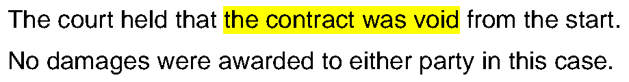

# No Fake Quotes

**Two small tools that check AI-assisted writing against the sources before anyone else does: a quote checker that catches invented or altered quotations, and a highlighter that marks excerpts with pixel accuracy.**

[Português](README.pt-BR.md)

---

## Why

The most damaging mistake in AI-assisted professional writing is a quotation that looks right and is not: a ruling that does not exist, a statute with one word changed, a passage that was paraphrased but kept the quotation marks. Reading it again does not reliably catch it. Comparing it with the source, word by word, does.

These tools came out of daily use in a professional-services practice where every quotation has to match its source.

## 1. `quote_checker.py`

Checks every quotation in a draft against the sources you saved.

```bash
python3 quote_checker.py draft.docx sources/
python3 quote_checker.py draft.md statute.pdf ruling.pdf --ocr --lang eng
```

**What counts as a quotation:** an indented block paragraph in `.docx`, a `>` block quote in `.md`, or any text in quotation marks with 8 words or more.

**How it compares:** it removes a final reference in parentheses and markers such as `[emphasis added]`, splits the quote at ellipses (`[...]`, `(...)`, `...`) and looks for each fragment in the sources, ignoring accents, case and punctuation.

**Output**, from the files in [`examples/`](examples):

```
OK        #2 block "Every public body shall publish, within thirty days of the r..." -> statute.txt
DIVERGE   #3 quote "except those classified as secret by a reasoned decision of ..." -> statute.txt (76%): draft "secret" vs source "confidential"; draft "of the minister" vs source "-"
NOT FOUND #4 quote "the body shall answer every request within ten business days..." -> fragment "the body shall answer every request within ten business days without exception a"
Summary: 3 quotations, 2 with problems, 1 source pages read.
```

- `OK`: found, with the file and page.
- `DIVERGE`: a close match exists. The checker shows the words that differ, so the quote can be fixed from the source.
- `NOT FOUND`: no saved source contains it. Find and save the source, or drop the quotation. Never rebuild it from memory.

The exit code is `1` when anything is not OK, so it can block a delivery in a script or a skill.

**Requirements:** Python 3 standard library and `pdftotext` (poppler-utils). `--ocr` also needs `pdftoppm` and `tesseract`.

## 2. `highlight.py`

Highlights a passage on an excerpt cut from a PDF, a scan or a screenshot, using the real position of each letter.

```bash
python3 highlight.py --pdf "Document.pdf" --pagina 3 --trecho "the contract was void" --saida excerpt.png
python3 highlight.py --imagem screenshot.png --trecho "literal passage" --saida excerpt.png
```



After drawing, it runs an independent OCR check on the pixels: no word partly highlighted, no highlight over blank space, nothing bleeding into the line above or below. It also writes a "magnifier" image with both ends of each highlighted line enlarged, for a quick visual check.

**Requirements:** `pdfplumber`, `Pillow`, `numpy`; the pixel check and image mode need Tesseract (`pytesseract`). Command-line options and messages are in Portuguese; the header of the file explains each option in English.

## Using them with Claude

Both tools work well as a mandatory step in a writing skill: draft, run the checker, fix every `DIVERGE` and `NOT FOUND`, and only then deliver. Saving each source to a `sources/` folder as soon as it is found makes the check automatic.

## Limitations

- The checker confirms literal correspondence. It does not judge whether the source is relevant, still in force, or correctly identified.
- Scanned PDFs need `--ocr`, and OCR errors can produce false `DIVERGE` results.
- Quotations shorter than 8 words in running text are not checked.

## License

[MIT](LICENSE)
